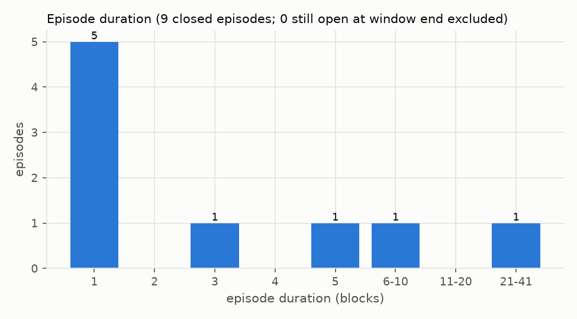

# Arbitrum DEX Arbitrage Research & Execution

**Research question:** after fees and gas, how often do the Uniswap v3 WETH/USDC pools on
Arbitrum One drift far enough apart to leave a profitable atomic arbitrage, and how long do
those gaps last?

## Latest result

Run [`20261104T211446Z_c57f8b8`](research/results/20261104T211446Z_c57f8b8/summary.md):
blocks 520,861,829 – 520,881,828, 2026-11-03 11:38:16 → 13:10:05 UTC. Pools: the 0.01%,
0.05% and 0.30% fee tiers.

**Headline.** Over 1.5 hours (20,000 blocks, 1,140 swaps), the WETH/USDC pools showed 9
episodes with a gap above the fee threshold. 56% of closed episodes lasted one block. Their
exact multi-tick gross profit sums to $0.0233, and none is profitable after gas (mean $0.013
per arbitrage). The single-tick approximation used in the first run
([`20261103T134604Z_5a6404c`](research/results/20261103T134604Z_5a6404c/summary.md)) gave
$0.0234: it overstated gross profit by $0.00008 (0.34%), almost all from the one episode whose
optimal trade crosses an initialized tick.

| Metric | Value |
|---|---|
| Blocks (N) | 20,000 (520861829..520881828) |
| Hours (H) | 1.53 |
| Swaps (S) | 1,140 |
| Gross episodes (G): gap > sum of fees | 9 (all on the 0.01%/0.05% pair) |
| Net-positive episodes (M) | 0 |
| Closed within 1 block (P) | 55.6% of closed episodes |
| Median / p90 duration (blocks) | 1 / 10 |
| Median / p90 duration (seconds) | 0 / 2 |
| Total gross profit, exact multi-tick (USD) | $0.0233 |
| Total gross profit, single-tick approximation (USD) | $0.0234 |
| Total net profit, net-positive episodes only (USD) | $0.00 |

Nine episodes in 1.5 hours is a small sample: treat the medians as indicative only.



## How to run

```bash
uv sync
cp .env.example .env   # set ARBITRUM_RPC_URL (archive-capable RPC, e.g. Alchemy)
uv run python -m data.collectors.swaps && uv run python -m research.replay.run
```

The first command fetches only the swap logs that are not cached yet. The second writes
`research/results/<run_id>/`. Run the tests with `uv run pytest`. To re-verify the pool
registry on-chain, run `uv run python -m data.pools.registry`. To re-check the exact v3 swap
port against QuoterV2 at the pinned block, run `uv run python -m research.parity.quoter_parity`.

Contracts (Foundry; see `contracts/README.md` for setup):

```bash
git submodule update --init --recursive
ln -s ../.env contracts/.env   # Foundry reads ARBITRUM_RPC_URL from contracts/.env
cd contracts && forge test -vv && forge test --gas-report
```

To save a fork-test run (config, per-test results, gas) under `research/results/<run_id>/`:
`uv run python -m research.forktests.run`. Python must be a final 3.14.x release: a pre-release
interpreter (e.g. 3.14.0a5) crashes on the locked wheels.

## Architecture

- `data/pools`: verifies pool and token addresses on-chain → `configs/pools.yaml`.
- `data/collectors`: fetches Swap logs, block headers, pool state and initialized-tick snapshots (tickBitmap + `ticks()`), cached as Parquet under `data/cache/`.
- `data/pricing`: exact `sqrtPriceX96` → USDC-per-WETH conversion; exact integer port of the Uniswap v3 swap (`v3_swap.py`).
- `research/parity`: QuoterV2 parity run → `tests/vectors/v3_swaps.json`.
- `research/replay` + `research/analytics`: block-level gaps, single-tick and exact multi-tick sizing, gas, episodes, metrics and charts → `research/results/`.
- `contracts/`: Foundry project. `V3ArbExecutor` (atomic two-pool v3 arbitrage through nested swap callbacks, factory-verified pools, onlyOwner, no funds held) and fork tests at block 520884405.

## Status

| | Component | Evidence |
|---|---|---|
| Done | Pool registry (on-chain verified) | `tests/test_registry.py` |
| Done | Swap log collector with Parquet cache | `tests/test_swaps_collector.py` |
| Done | sqrtPriceX96 pricing | `tests/test_v3_price.py`; matches `slot0()` exactly (`tests/test_v3_price_onchain.py`) |
| Done | Replay engine: gaps, single-tick sizing, NodeInterface gas, episodes | `tests/test_replay_episodes.py`; run `20261103T134604Z_5a6404c` |
| Done | Metrics, summary and charts | run `20261103T134604Z_5a6404c` |
| Done | Initialized-tick snapshot collector | `tests/test_v3_swap_parity.py` (integration) |
| Done | Exact Uniswap v3 swap port (multi-tick) | `tests/test_v3_swap_math.py`; 30/30 exact QuoterV2 matches, run `20261104T204637Z_3c7738a` |
| In progress | LEARNING.md, updated after each component | `LEARNING.md` |
| Done | Exact multi-tick sizing per episode (peak block), single-tick kept for comparison | `tests/test_replay_multitick.py`; run `20261104T211446Z_c57f8b8` |
| Done | Foundry arbitrage contract and fork tests (`contracts/`) | `forge test`: 18/18 pass (SYNTHETIC gap scenarios, callback auth, revert paths, 256-run fuzz, 30/30 on-chain swap parity with the Python vectors); run `20261105T190351Z_94c0dfb` |
| Planned | Longer windows and more pools/DEXs | none yet |

## Limitations

- **Exact sizing, idealised execution.** Gross profit is the exact multi-tick optimum on the
  on-chain state at each episode's peak block, but it still assumes perfect execution at the
  end-of-block state and no competition. The peak block itself is chosen with the single-tick
  approximation.
- **Gas estimate.** One NodeInterface simulation per pair, routed through SwapRouter02 rather
  than a dedicated arbitrage contract, so it likely overstates gas. It is priced at each
  episode's peak-block base fee. The L1 data price was 0 at the probe block because of
  Arbitrum's L1 pricing surplus; this was measured, not assumed. Gas is probed once per run.
- **No on-chain execution.** The executor is tested on a local fork only. No transactions are
  sent and the repo holds no keys. The fork profit (519.94 USDC) is from a SYNTHETIC gap that a
  test account created with a 100 WETH dump; it is not a real opportunity. Forge gas figures are
  L2 execution only (no L1 data fee).
- **Uniswap v3 pools only**: the WETH/USDC 0.01%, 0.05% and 0.30% tiers.
- Other simplifications:
  - The window ends at the *finalized* block.
  - Gaps that open and close within a single block are invisible.
  - In-range liquidity changes from Mint/Burn between swaps are not replayed.
  - Summing across pairs double-counts shared liquidity.
  - 1 USDC = 1 USD.

## Changelog

### 2026-11-05
- Foundry project in `contracts/` (forge-std v1.17.0 submodule, solc 0.8.28, Cancun). The fork
  block (520884405) is pinned in `foundry.toml`; the RPC URL comes from `.env`.
- `V3ArbExecutor`: atomic two-pool arbitrage through nested `uniswapV3SwapCallback`s. Pools are
  verified with `factory.getPool`, the callback is single-use and authorises only the expected
  pool, profit goes to the owner inside the trade, owner-only rescue.
- Fork tests: SYNTHETIC gap → 519.940023 USDC gross on 50,000 USDC; `minProfit` and no-gap
  reverts; non-pool / fake-pool callbacks rejected; 256-run fuzz with no loss without revert;
  all 30 Python swap vectors reproduced exactly by real swaps on the fork. A SYNTHETIC
  `execute` costs 340,692 L2 gas. Saved as run `20261105T190351Z_94c0dfb`
  (`research/forktests/run.py`, from a clean commit).
- Python environment: `.venv` had been built on CPython 3.14.0a5 (alpha), which crashed on the
  locked wheels; rebuilt on 3.14.10. 596/596 Python tests pass.

### 2026-11-04
- Replay: exact multi-tick sizing and gross profit at each episode's peak block, using the
  swap port on on-chain tick snapshots; single-tick numbers kept as comparison columns.
  Run `20261104T211446Z_c57f8b8`: single-tick overstated gross by 0.34%.
- Swap collector: `head` can be a fixed (finalized) block number, to re-collect a past window;
  `configs/replay.yaml` pins the first run's window.
- Exact Python port of the Uniswap v3 swap (`data/pricing/v3_swap.py`): TickMath,
  SqrtPriceMath, SwapMath, FullMath, TickBitmap and the swap loop, integers only.
- Initialized-tick snapshot collector (`data/collectors/ticks.py`), Parquet cache per bitmap word.
- QuoterV2 parity at block 520884405: 30/30 exact-input quotes match exactly (3 pools × 5 sizes
  × 2 directions). Vectors saved to `tests/vectors/v3_swaps.json` for later Foundry tests.

### 2026-11-03
- Project scaffold (uv, Python 3.11+).
- On-chain verified pool registry for WETH/USDC Uniswap v3 (fee tiers 100/500/3000).
- Swap log collector with retries, provider-sized chunks and a Parquet range cache.
- Exact sqrtPriceX96 → USDC/WETH pricing, checked against `slot0()`.
- Replay engine: per-pair gaps, single-tick sizing, NodeInterface gas, episodes, metrics and charts.
- First results: run `20261103T134604Z_5a6404c`.
- Documented why NodeInterface's L1 gas component is 0 (Arbitrum L1 pricing surplus).

---

I am iterating and documenting what I learn in [LEARNING.md](LEARNING.md).
