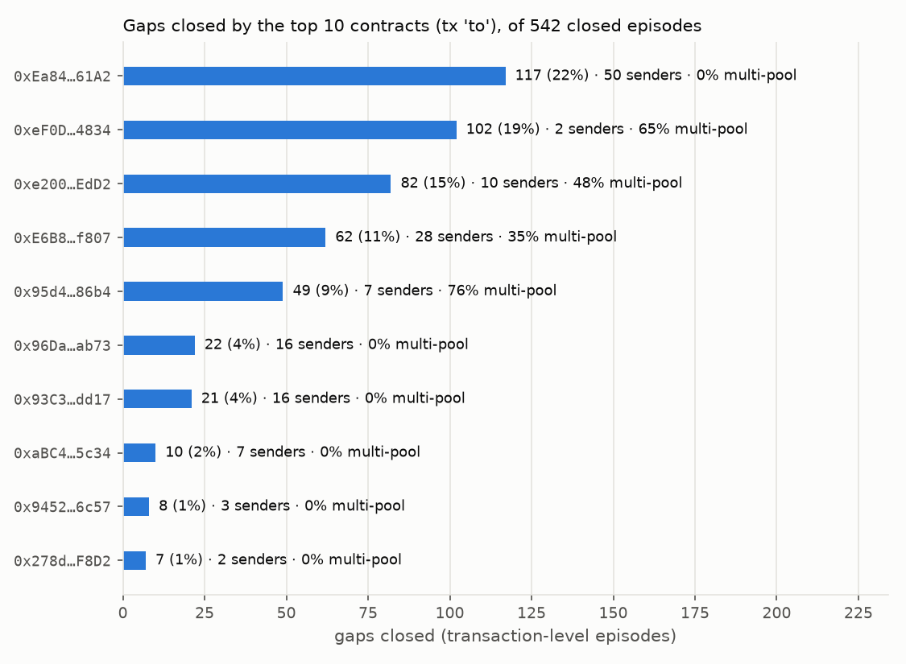

# Arbitrum DEX Arbitrage Research & Execution

**Research question:** after fees and gas, how often do the Uniswap v3 WETH/USDC pools on
Arbitrum One drift far enough apart to leave a profitable atomic arbitrage, and how long do
those gaps last?

## Latest result

Run [`20261109T213505Z_a42a515`](research/results/20261109T213505Z_a42a515/summary.md): 24 hours, blocks 520,575,466 – 520,881,828
(2026-11-02 13:10:06 → 2026-11-03 13:10:05 UTC). Pools: Uniswap v3 WETH/USDC 0.01%, 0.05%, 0.30%
and SushiSwap v3 WETH/USDC 0.05%.

**Headline.**
- The block-level replay found 312 episodes in 24 hours with a gap above the fee threshold.
  Their exact multi-tick gross sums to **$0.72**. 4 are net-positive after gas, together
  **$0.02**.
- Replaying after every transaction finds **542** episodes. The block level misses 226 (42%),
  which open and close inside a single block and hold 57% of the gross.
- **76%** of gaps are closed by the very next transaction on the pair's pools.
- Almost none of the closing transactions trades both pools of the pair: **1 of 542**. 36%
  also swap in other venues. 64% touch only one of our pools: a directional trade, or a
  CEX-DEX arbitrage whose other leg is off-chain.
- Concentration sits behind contracts, not senders: the top 5 `to` contracts close 76% of the
  gaps, against 26% for the top 5 senders.

| Metric | Block-level | Transaction-level |
|---|---|---|
| Episodes (gap > sum of fees) | 312 | 542 |
| Net-positive at gas ×0.5 / ×1 / ×2 | 24 / 4 / 0 | 62 / 23 / 8 |
| Gross profit, exact multi-tick (USD) | $0.7224 | $2.1534 |
| Net profit at gas ×1, net-positive episodes only (USD) | $0.0204 | $0.6046 |
| Opened and closed inside one block | invisible | 226 (41.7%) |
| Median duration | 1 block | 1 transaction on the pair's pools |
| Replayed state vs archive `slot0()`/`liquidity()` | n/a | 0 / 492 mismatches |

Gas per arbitrage is **$0.016–0.018**: 340,692 L2 gas for the executor's `execute()` (forge,
SYNTHETIC trade), plus 22.5k intrinsic, plus 0 L1 data gas. The L1 component was measured at
each of the 222 peak blocks.

Read the transaction-level numbers as *what existed*, not what was capturable. Each one
assumes our transaction was ordered right after the one that opened the gap. Episodes on pairs
with the Sushi pool (173 of 312 at block level) are real price gaps, but `V3ArbExecutor`
cannot trade them as deployed: it trusts only the Uniswap factory.



Earlier runs:
- [`20261104T211446Z_c57f8b8`](research/results/20261104T211446Z_c57f8b8/summary.md): 1.5 h,
  9 episodes, exact multi-tick vs single-tick.
- [`20261103T134604Z_5a6404c`](research/results/20261103T134604Z_5a6404c/summary.md): the first
  run, single-tick only.

## How to run

```bash
uv sync
cp .env.example .env   # set ARBITRUM_RPC_URL (archive-capable RPC, e.g. Alchemy)
uv run python -m data.collectors.pool_logs 520575466 520881828   # Swap + Mint/Burn, one pass (24 h: ~1h45 on Alchemy Free)
uv run python -m research.replay.run
```

The collector fetches only the logs that are not cached yet. The window is pinned in
`configs/replay.yaml`. The replay writes `research/results/<run_id>/`. Run the tests with `uv run pytest`. To re-verify the pool
registry on-chain, run `uv run python -m data.pools.registry`. To re-check the exact v3 swap
port against QuoterV2 at the pinned block, run `uv run python -m research.parity.quoter_parity`.

Contracts (Foundry; see `contracts/README.md` for setup):

```bash
git submodule update --init --recursive
ln -s ../.env contracts/.env   # Foundry reads ARBITRUM_RPC_URL from contracts/.env
cd contracts && forge test -vv && forge test --gas-report
```

To save a fork-test run (config, per-test results, gas) under `research/results/<run_id>/`:
`uv run python -m research.forktests.run`. Python must be a final 3.14.x release: a pre-release
interpreter (e.g. 3.14.0a5) crashes on the locked wheels.

## Architecture

- `data/pools`: verifies pool and token addresses on-chain → `configs/pools.yaml`.
- `data/collectors`: fetches Swap and Mint/Burn logs, transaction indices, block headers, pool state and initialized-tick snapshots (tickBitmap + `ticks()`), cached as Parquet under `data/cache/`.
- `data/pricing`: exact `sqrtPriceX96` → USDC-per-WETH conversion; exact integer port of the Uniswap v3 swap (`v3_swap.py`).
- `research/parity`: QuoterV2 parity run → `tests/vectors/v3_swaps.json`.
- `research/replay` + `research/analytics`: block-level gaps, single-tick and exact multi-tick sizing, gas (executor forge gas + per-block NodeInterface intrinsic/L1), sensitivity, episodes, metrics and charts → `research/results/`. `txlevel.py` replays the state after every transaction (Swap + Mint/Burn), checks it against archive snapshots and finds intra-block episodes the block level misses. `closers.py` identifies and classifies the transaction that closed each one.
- `contracts/`: Foundry project. `V3ArbExecutor` (atomic two-pool v3 arbitrage through nested swap callbacks, factory-verified pools, onlyOwner, no funds held) and fork tests at block 520884405.

## Status

| | Component | Evidence |
|---|---|---|
| Done | Pool registry (on-chain verified) | `tests/test_registry.py` |
| Done | Swap log collector with Parquet cache | `tests/test_swaps_collector.py` |
| Done | sqrtPriceX96 pricing | `tests/test_v3_price.py`; matches `slot0()` exactly (`tests/test_v3_price_onchain.py`) |
| Done | Replay engine: gaps, single-tick sizing, NodeInterface gas, episodes | `tests/test_replay_episodes.py`; run `20261103T134604Z_5a6404c` |
| Done | Metrics, summary and charts | run `20261103T134604Z_5a6404c` |
| Done | Initialized-tick snapshot collector | `tests/test_v3_swap_parity.py` (integration) |
| Done | Exact Uniswap v3 swap port (multi-tick) | `tests/test_v3_swap_math.py`; 30/30 exact QuoterV2 matches, run `20261104T204637Z_3c7738a` |
| In progress | LEARNING.md, updated after each component | `LEARNING.md` |
| Done | Exact multi-tick sizing per episode (peak block), single-tick kept for comparison | `tests/test_replay_multitick.py`; run `20261104T211446Z_c57f8b8` |
| Done | Foundry arbitrage contract and fork tests (`contracts/`) | `forge test`: 18/18 pass (SYNTHETIC gap scenarios, callback auth, revert paths, 256-run fuzz, 30/30 on-chain swap parity with the Python vectors); run `20261105T190351Z_94c0dfb` |
| Done | Transaction-level replay (Swap + Mint/Burn), archive data-quality checks, block vs tx comparison | `tests/test_replay_txlevel.py`; run `20261109T213505Z_a42a515` (0/492 mismatches) |
| Done | Gas from the executor's forge report + per-block L1 price, sensitivity ×0.5/×1/×2 | `tests/test_replay_gas.py`; run `20261109T213505Z_a42a515` |
| Done | 24-hour window, one-pass Swap + Mint/Burn collection, Multicall3 tick reads | `tests/test_swaps_collector.py`; run `20261109T213505Z_a42a515` |
| Done | SushiSwap v3 WETH/USDC 0.05% (factory from Sushi's package, verified on-chain) | `tests/test_registry.py` |
| Done | Who closed the gaps: closer sender/contract/index/gas, receipt-based closer kind | `tests/test_closers.py`; run `20261109T213505Z_a42a515` |
| Planned | Executor support for a second factory (Sushi pairs), gas per trade size | none yet |

## Limitations

- **Exact sizing, idealised execution.** Gross profit is the exact multi-tick optimum on the
  on-chain state at each episode's peak, block-level or transaction-level. It still assumes
  perfect execution and no competition. At the transaction level, it assumes our transaction
  sits right behind the one that opened the gap. The closer analysis shows that slot is
  contested: 76% of gaps are gone after one transaction.
- **Gas from one SYNTHETIC trade.** `execute()` = 340,692 L2 gas from a 50,000-USDC fork trade
  that crosses many ticks. That probably overstates the gas of the few-dollar trades here,
  hence the ×0.5/×1/×2 table. Intrinsic and L1 gas are measured per peak block. L1 data gas
  was 0 at every peak block (Arbitrum's L1 pricing surplus), as measured, not assumed. No
  priority fee or Timeboost bid is modelled.
- **Executor coverage.** `V3ArbExecutor` verifies pools against the Uniswap factory only, so
  Sushi pairs are reported but flagged `executable_by_executor = false`. Sushi sizing uses the
  Uniswap v3 swap port; Sushi has not been parity-tested against its own quoter.
- **Closer classification is by receipt, not intent.** "Multi-pool" mixes cross-venue
  arbitrage and aggregator routes. "Single pool" mixes directional trades and CEX-DEX
  arbitrage. The recognised Swap events are not exhaustive.
- **No on-chain execution.** The executor is tested on a local fork only. No transactions are
  sent and the repo holds no keys. The fork profit (519.94 USDC) is from a SYNTHETIC gap.
- Other simplifications:
  - The window ends at the *finalized* block.
  - Block-level gap detection uses swap-only liquidity, which was stale at 37 of 492
    checkpoints. The transaction level replays Mint/Burn and matched at all 492.
  - Summing across pairs double-counts shared liquidity.
  - 1 USDC = 1 USD.

## Changelog

### 2026-11-09
- Transaction-level replay (`research/replay/txlevel.py`):
  - Mint/Burn collection; events ordered by (block, tx index, log index).
  - State is rebuilt after every transaction and checked against archive
    `slot0()`/`liquidity()` every 2,500 blocks: 0/492 mismatches.
  - Intra-block episodes with durations in transactions, plus a block-vs-transaction
    comparison in `summary.md`. A built-in consistency check against the block level passed.
- Gas:
  - The SwapRouter02 probe is replaced by the executor's forge `execute()` gas (340,692) plus
    NodeInterface intrinsic and L1 gas at each episode's peak block.
  - ArbGasInfo L1 prices are recorded per peak block.
  - Sensitivity table ×0.5/×1/×2.
- 24-hour window (306,363 blocks):
  - One-pass Swap + Mint/Burn collection (`data/collectors/pool_logs.py`); swap rows now
    carry `transactionIndex`.
  - Tick snapshots read through Multicall3, verified at use.
- SushiSwap v3 WETH/USDC 0.05% added to the registry after on-chain checks (factory from
  Sushi's `sushi` package v7.6.1; `getPool`, `fee()`, `tickSpacing()`, tokens, callback
  selector in bytecode). The other Sushi tiers are dust and were left out.
- Who closed the gaps (`research/analytics/closers.py`):
  - For each closing transaction: sender, `to`, index, gas used and the pools it swapped in.
  - Rankings by sender and by contract, top-5 shares, delay medians.
  - A chart of the top contracts and a competition reading in `summary.md`.
- RPC robustness: the web3 provider retries 429/5xx, and `RpcClient` retries Alchemy's
  transient "layer stale" error.
- The replay result moves to 24 h: run `20261109T213505Z_a42a515`.


### 2026-11-05
- Foundry project in `contracts/` (forge-std v1.17.0 submodule, solc 0.8.28, Cancun). The fork
  block (520884405) is pinned in `foundry.toml`; the RPC URL comes from `.env`.
- `V3ArbExecutor`: atomic two-pool arbitrage through nested `uniswapV3SwapCallback`s. Pools are
  verified with `factory.getPool`, the callback is single-use and authorises only the expected
  pool, profit goes to the owner inside the trade, owner-only rescue.
- Fork tests: SYNTHETIC gap → 519.940023 USDC gross on 50,000 USDC; `minProfit` and no-gap
  reverts; non-pool / fake-pool callbacks rejected; 256-run fuzz with no loss without revert;
  all 30 Python swap vectors reproduced exactly by real swaps on the fork. A SYNTHETIC
  `execute` costs 340,692 L2 gas. Saved as run `20261105T190351Z_94c0dfb`
  (`research/forktests/run.py`, from a clean commit).
- Python environment: `.venv` had been built on CPython 3.14.0a5 (alpha), which crashed on the
  locked wheels; rebuilt on 3.14.10. 596/596 Python tests pass.

### 2026-11-04
- Replay: exact multi-tick sizing and gross profit at each episode's peak block, using the
  swap port on on-chain tick snapshots; single-tick numbers kept as comparison columns.
  Run `20261104T211446Z_c57f8b8`: single-tick overstated gross by 0.34%.
- Swap collector: `head` can be a fixed (finalized) block number, to re-collect a past window;
  `configs/replay.yaml` pins the first run's window.
- Exact Python port of the Uniswap v3 swap (`data/pricing/v3_swap.py`): TickMath,
  SqrtPriceMath, SwapMath, FullMath, TickBitmap and the swap loop, integers only.
- Initialized-tick snapshot collector (`data/collectors/ticks.py`), Parquet cache per bitmap word.
- QuoterV2 parity at block 520884405: 30/30 exact-input quotes match exactly (3 pools × 5 sizes
  × 2 directions). Vectors saved to `tests/vectors/v3_swaps.json` for later Foundry tests.

### 2026-11-03
- Project scaffold (uv, Python 3.11+).
- On-chain verified pool registry for WETH/USDC Uniswap v3 (fee tiers 100/500/3000).
- Swap log collector with retries, provider-sized chunks and a Parquet range cache.
- Exact sqrtPriceX96 → USDC/WETH pricing, checked against `slot0()`.
- Replay engine: per-pair gaps, single-tick sizing, NodeInterface gas, episodes, metrics and charts.
- First results: run `20261103T134604Z_5a6404c`.
- Documented why NodeInterface's L1 gas component is 0 (Arbitrum L1 pricing surplus).

---

I am iterating and documenting what I learn in [LEARNING.md](LEARNING.md).
