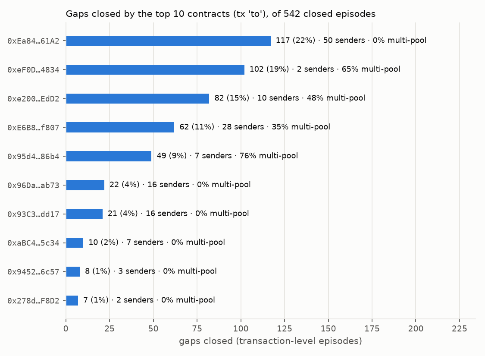

# Replay 20261109T213505Z_a42a515

**Headline.** Over 24.0 hours (306,363 blocks, 25,154 swaps), the WETH/USDC pools showed 312 episodes with a gap above the fee threshold, 55% of closed episodes lasted one block, and their exact multi-tick gross profit sums to $0.7224; $0.02 net of gas over the 4 net-positive episodes.

| Metric | Value |
|---|---|
| Blocks (N) | 306,363 (520575466..520881828) |
| Hours (H) | 24.00 |
| Swaps (S) | 25,154 |
| Gross episodes (G): gap > sum of fees | 312 |
| Net-positive episodes (M) | 4 |
| Closed within 1 block (P) | 55.4% of closed episodes |
| Median / p90 duration (blocks) | 1 / 43 |
| Median / p90 duration (seconds) | 1 / 12 |
| Episodes touching window edge (censored) | 0 |
| Total gross profit, exact multi-tick (USD) | $0.7224 |
| Total gross profit, single-tick approximation (USD), for comparison | $0.7228 |
| Total net profit, net-positive episodes only (USD) | $0.0204 |
| Single-tick peak trade stays before the next tickSpacing boundary (single-tick math provably exact; crossing a boundary does not mean L changes) | 29.5% of episodes |

## Per pair

| Pair (fee tiers) | Threshold (bps) | Episodes | Net-positive | Max gap (bps) | Median duration (blocks) | Gross, multi-tick (USD) | Gross, single-tick (USD) | Mean gas (USD) |
|---|---|---|---|---|---|---|---|---|
| 100-3000 | 31 | 8 | 0 | 34.0 | 1 | $0.0138 | $0.0138 | $0.0164 |
| 100-500 | 6 | 131 | 2 | 11.7 | 1 | $0.3014 | $0.3016 | $0.0165 |
| 100-sushi500 | 6 | 164 | 2 | 13.0 | 2 | $0.3614 | $0.3615 | $0.0165 |
| 500-sushi500 | 10 | 9 | 0 | 12.1 | 1 | $0.0458 | $0.0458 | $0.0171 |

## Single-tick vs exact multi-tick

Summed over the 312 episodes, the single-tick approximation gave **$0.722804** gross; the exact multi-tick simulation at the same peak blocks gives **$0.722382**. The single-tick number overstated gross profit by **$0.000422** (0.06% of the exact value).

- Stale liquidity: $0.000000. The single-tick formula re-run with the on-chain liquidity at the peak block gives $0.722804 (8 of 312 episodes had in-range liquidity changed by a Mint/Burn since the pool's last swap).
- Tick crossings: $0.000227, from the 25 episode(s) whose exact optimal trade crosses at least one initialized tick.
- Integer rounding: $0.000195 over the other 287 episodes (the exact profit is a whole number of raw USDC units, 1e-6 USDC; the single-tick formula is continuous).

| Pair | Peak block | Gap (bps) | Single-tick size / gross (USD) | Single-tick, on-chain L, gross (USD) | Multi-tick size / gross (USD) | Ticks crossed (cheap, exp.) | L matches replay |
|---|---|---|---|---|---|---|---|
| 100-sushi500 | 520581542 | 8.98 | 37.05 / 0.005504 | 0.005504 | 37.00 / 0.005495 | 0, 1 | yes |
| 100-sushi500 | 520581546 | 12.99 | 87.06 / 0.030404 | 0.030404 | 86.74 / 0.030402 | 0, 1 | yes |
| 500-sushi500 | 520581550 | 12.08 | 165.24 / 0.017107 | 0.017107 | 166.16 / 0.017106 | 0, 0 | yes |
| 100-sushi500 | 520581561 | 11.10 | 63.59 / 0.016209 | 0.016209 | 63.97 / 0.016208 | 0, 0 | yes |
| 500-sushi500 | 520581568 | 11.57 | 124.36 / 0.009683 | 0.009683 | 124.27 / 0.009683 | 0, 0 | yes |
| 100-sushi500 | 520581602 | 10.63 | 57.80 / 0.013349 | 0.013349 | 57.80 / 0.013342 | 0, 1 | yes |
| 100-sushi500 | 520582219 | 10.08 | 49.80 / 0.010135 | 0.010135 | 49.61 / 0.010135 | 0, 0 | yes |
| 100-500 | 520609719 | 10.82 | 69.11 / 0.016620 | 0.016620 | 69.50 / 0.016619 | 0, 0 | yes |
| 100-sushi500 | 520609719 | 10.96 | 60.43 / 0.014957 | 0.014957 | 60.71 / 0.014955 | 0, 1 | yes |
| 100-500 | 520613020 | 9.56 | 51.71 / 0.009187 | 0.009187 | 51.24 / 0.009092 | 0, 1 | yes |
| 100-500 | 520613023 | 11.71 | 81.67 / 0.023290 | 0.023290 | 81.88 / 0.023288 | 0, 1 | yes |
| 100-500 | 520613051 | 10.26 | 60.77 / 0.012917 | 0.012917 | 60.99 / 0.012916 | 0, 0 | yes |
| 500-sushi500 | 520613131 | 11.78 | 140.59 / 0.012455 | 0.012455 | 140.49 / 0.012455 | 0, 0 | yes |
| 100-500 | 520613131 | 9.05 | 43.55 / 0.006624 | 0.006624 | 44.05 / 0.006623 | 0, 0 | yes |
| 100-500 | 520645394 | 8.83 | 40.83 / 0.005764 | 0.005764 | 40.83 / 0.005764 | 0, 0 | yes |
| 100-sushi500 | 520647541 | 8.97 | 36.30 / 0.005376 | 0.005376 | 36.25 / 0.005376 | 0, 0 | yes |
| 100-sushi500 | 520648787 | 9.11 | 38.07 / 0.005912 | 0.005912 | 38.21 / 0.005910 | 1, 0 | yes |
| 100-500 | 520653478 | 9.12 | 45.07 / 0.007025 | 0.007025 | 45.43 / 0.007024 | 0, 0 | yes |
| 100-sushi500 | 520673223 | 9.84 | 46.91 / 0.008982 | 0.008982 | 46.89 / 0.008982 | 0, 0 | yes |
| 100-sushi500 | 520673252 | 9.93 | 48.01 / 0.009408 | 0.009408 | 48.10 / 0.009408 | 0, 0 | yes |
| 100-500 | 520673252 | 9.13 | 45.21 / 0.007073 | 0.007073 | 45.43 / 0.007073 | 0, 0 | yes |
| 100-sushi500 | 520675484 | 9.60 | 43.97 / 0.007909 | 0.007909 | 44.05 / 0.007908 | 0, 0 | yes |
| 100-sushi500 | 520678711 | 9.06 | 37.43 / 0.005717 | 0.005717 | 37.44 / 0.005717 | 0, 0 | yes |
| 100-500 | 520697857 | 9.49 | 50.36 / 0.008765 | 0.008765 | 50.58 / 0.008764 | 0, 0 | yes |
| 100-sushi500 | 520725686 | 10.71 | 57.70 / 0.013569 | 0.013569 | 57.61 / 0.013569 | 0, 0 | yes |
| 100-500 | 520725686 | 10.00 | 57.82 / 0.011552 | 0.011552 | 57.87 / 0.011551 | 0, 0 | yes |
| 100-500 | 520754140 | 8.91 | 41.93 / 0.006083 | 0.006083 | 42.17 / 0.006082 | 0, 0 | yes |
| 100-3000 | 520754140 | 33.99 | 41.41 / 0.005979 | 0.005979 | 41.73 / 0.005978 | 0, 0 | yes |
| 100-500 | 520756744 | 8.94 | 42.47 / 0.006239 | 0.006239 | 42.70 / 0.006238 | 0, 0 | yes |
| 100-sushi500 | 520756744 | 9.16 | 38.62 / 0.006083 | 0.006083 | 39.03 / 0.006082 | 0, 0 | yes |
| 100-500 | 520803287 | 10.63 | 66.59 / 0.015384 | 0.015384 | 67.11 / 0.015382 | 0, 0 | yes |
| 100-sushi500 | 520803287 | 9.29 | 40.21 / 0.006613 | 0.006613 | 40.39 / 0.006613 | 0, 0 | yes |
| 100-500 | 520809116 | 10.54 | 65.55 / 0.014848 | 0.014848 | 65.79 / 0.014847 | 0, 0 | yes |
| 100-sushi500 | 520809116 | 9.49 | 42.81 / 0.007469 | 0.007469 | 42.81 / 0.007468 | 0, 0 | yes |
| 100-sushi500 | 520827556 | 9.81 | 46.68 / 0.008874 | 0.008874 | 46.67 / 0.008867 | 1, 0 | yes |
| 100-500 | 520830644 | 10.58 | 66.23 / 0.015138 | 0.015138 | 66.54 / 0.015137 | 0, 0 | yes |
| 100-sushi500 | 520830644 | 10.10 | 50.27 / 0.010285 | 0.010285 | 50.48 / 0.010284 | 0, 0 | yes |
| 100-500 | 520871445 | 9.22 | 46.91 / 0.007551 | 0.007551 | 46.62 / 0.007477 | 1, 0 | yes |
| 100-sushi500 | 520871516 | 11.44 | 66.36 / 0.018041 | 0.018041 | 66.76 / 0.018040 | 0, 0 | yes |
| 100-500 | 520871527 | 9.97 | 56.95 / 0.011280 | 0.011280 | 57.47 / 0.011279 | 0, 0 | yes |

(Top 40 of 312 episodes by exact gross, in block order; all in `episodes.parquet`.)

Sizes differ more than profits because profit is flat near the optimum.

## Definitions

- An **episode** is a run of consecutive blocks in which the same pool pair's end-of-block gap exceeds the sum of the two pool fees. Duration in blocks = end - start + 1; in seconds = timestamp of the block that closed it minus the start block's timestamp (Arbitrum timestamps have 1 s resolution, so 1-block episodes often show 0 s). Durations exclude episodes still open at the window end.
- **Gross** is taken at the episode's peak block; **net** = gross - gas at that block.
- Totals sum one capture per episode.

## Gas assumption

- Method: **executor_forge_plus_nodeinterface_per_block**. execute() L2 gas 340,692 from the V3ArbExecutor Foundry gas report (research/results/20261105T190351Z_94c0dfb/config.json gas.synthetic_execute (forge gas report); SYNTHETIC trade: poolA=0.30%, poolB=0.05%, zeroForOne=false (USDC in), amountIn=50,000 USDC, minProfit=1 USDC) + intrinsic and L1 data gas measured per episode with NodeInterface.gasEstimateComponents at the peak block on the episode's own execute() calldata; priced at the peak block's base fee.
- execute() L2 gas: **340,692** (forge, fork block 520884405, commit `94c0dfb`). For reference, all 269 execute() calls in the fork suite (reverts and fuzz sizes included): median 704,361.
- Intrinsic L2 gas (NodeInterface, per peak block): 22,543 - 22,579.
- L1 data gas (NodeInterface gasEstimateForL1, per peak block): 0; L1 base fee estimate 0 wei (ArbGasInfo: 0 wei, 0 wei per L1 calldata byte) over 222 peak blocks.
- Total gas units per episode: 363,235 - 363,271; base fee at peak blocks 0.0200 - 0.0219 gwei (header; NodeInterface reports 0.0200 - 0.0224 gwei); cost 0.0163 - 0.0181 USD.

## Simplifications (read before using these numbers)

- Gross profit is the EXACT multi-tick optimum at the episode's peak block: both legs run through the Uniswap v3 swap port (data/pricing/v3_swap.py, QuoterV2-parity tested) on the on-chain tick state at that block; optimal size by integer search (within a few raw units of the true optimum). It still assumes perfect execution at the end-of-block state and no competition.
- The peak block is chosen by the SINGLE-TICK gross (constant product on the current tick's virtual reserves), as in the first run; the single-tick numbers are kept as *_single_tick comparison columns.
- Gap detection uses in-range liquidity forward-filled from Swap events (Mint/Burn between swaps are not replayed); the multi-tick sizing reads the real on-chain liquidity at the peak block instead.
- Gap threshold is the sum of the two fees (spec); the exact break-even 1/((1-fa)(1-fb))-1 is slightly higher and is what the profit formula uses, so a few gross episodes can have ~0 profit.
- Block-level states are end-of-block; gaps opened and closed within one block are invisible to the block-level replay (the transaction-level section, when enabled, measures them).
- Pairs are evaluated independently; simultaneous episodes on pairs sharing a pool compete for the same liquidity, so summed profits overstate what one arbitrageur could capture.
- Gas = execute() L2 gas from ONE SYNTHETIC fork-test trade (50,000 USDC, 0.30% -> 0.05%, many ticks crossed: probably an overestimate for small arbitrages) + intrinsic and L1 data gas measured per episode at its peak block (NodeInterface, archive eth_call). See the gas sensitivity table for x0.5 / x2.
- V3ArbExecutor verifies pools against the Uniswap v3 factory only: episodes on pairs with the SushiSwap pool are real price gaps but not executable by the contract as deployed (executable_by_executor = false).
- Profits in USDC with 1 USDC = 1 USD.

## Reproducibility

- Git commit `a42a515e66bae17b2598568b05c88253abf45a5c` (with uncommitted changes); RPC provider `arb-mainnet.g.alchemy.com`; registry verified at block 522767219.
- Full config in `config.json`; episodes in `episodes.parquet`.

## Gas sensitivity

M = episodes with exact gross > k x gas (gas = forge execute() + measured intrinsic and L1 gas, at the peak block's base fee).

| Gas multiplier k | M, block-level | Net, block-level (USD) | M, transaction-level | Net, transaction-level (USD) |
|---|---|---|---|---|
| x0.5 | 24 | $0.1319 | 62 | $0.9259 |
| x1 | 4 | $0.0204 | 23 | $0.6046 |
| x2 | 0 | $0.0000 | 8 | $0.3734 |

Of the 312 block-level episodes, 139 are on Uniswap-only pairs (executable by V3ArbExecutor as deployed); M at x1 among them: 2.

## Transaction-level replay

State rebuilt after each of 25,214 transactions touching the pools (25,154 Swap, 348 Mint, 609 Burn events), ordered by (block, transaction index, log index).

### Data quality

Replayed end-of-block state vs archive `slot0()`/`liquidity()` at 492 (block, pool) checkpoints: every 2,500 blocks plus the window's last block, 123 blocks (listed in config.json), checked for every pool.

| Check | Mismatches |
|---|---|
| Any field (sqrtPriceX96, tick or liquidity): **mismatch rate** | 0 / 492 (0.00%) |
| sqrtPriceX96 | 0 |
| tick | 0 |
| liquidity, transaction-level (Swap + Mint/Burn) | 0 |
| liquidity, swap-only (what the block-level replay uses) | 37 |

### Block-level vs transaction-level

| Metric | Block-level | Transaction-level |
|---|---|---|
| Episodes | 312 | 542 |
| Net-positive episodes | 4 | 23 |
| Gross profit, exact multi-tick, one capture per episode (USD) | $0.7224 | $2.1534 |
| Opened and closed inside one block | (invisible) | 226 (41.7% of closed) |
| Median / p90 duration, transactions on the pair's pools | n/a | 1 / 3 |
| Median / p90 duration, blocks (transaction level: close - start block, 0 = same block) | 1 / 43 | 1 / 26 |
| Closing transaction trades both pools of the pair | n/a | 0.2% of closed |

**Missed by the block-level replay: 226 of 542 transaction-level episodes (41.7%)**, with exact gross $1.2316 (57.2% of the transaction-level total) and 15 net-positive.
Their peak gaps: median 7.32 bps, max 37.20 bps; median gross $0.001040, max $0.277785. Median duration 1 transaction(s) on the pair's pools, median 2 transaction indices between opener and closer.

The 316 visible transaction-level episodes map onto 312 block-level episodes; 4 block-level episode(s) contain more than one transaction-level episode (the gap closed and reopened inside a block). Consistency check: the blocks at whose end a transaction-level episode is open equal the block-level episode blocks (**passed**).
Exact multi-tick tick table exact for 534 of 542 episodes (see simplifications).

| Pair | Start (block / tx idx) | Close (block / tx idx) | Txs | Gap (bps) | Gross, exact (USD) | Net (USD) | Block-level | Closer trades both pools |
|---|---|---|---|---|---|---|---|---|
| 100-sushi500 | 520581542 / 13 | 520581543 / 6 | 2 | 11.71 | 0.020263 | 0.002915 | episode #140 | no |
| 100-sushi500 | 520581546 / 8 | 520581547 / 9 | 2 | 12.99 | 0.030402 | 0.013183 | episode #141 | no |
| 500-sushi500 | 520581548 / 21 | 520581551 / 1 | 11 | 12.08 | 0.017106 | -0.000475 | episode #305 | no |
| 100-sushi500 | 520581551 / 12 | 520581551 / 17 | 1 | 11.28 | 0.017332 | -0.000737 | missed | no |
| 100-sushi500 | 520581561 / 21 | 520581562 / 1 | 1 | 11.10 | 0.016208 | -0.000974 | episode #142 | no |
| 500-sushi500 | 520581568 / 15 | 520581569 / 29 | 5 | 12.68 | 0.028470 | 0.011648 | episode #306 | no |
| 100-500 | 520581568 / 15 | 520581570 / 28 | 9 | 11.02 | 0.018550 | 0.001332 | episode #10 | no |
| 100-sushi500 | 520581602 / 25 | 520581609 / 2 | 4 | 10.63 | 0.013342 | -0.003685 | episode #143 | no |
| 100-sushi500 | 520587931 / 4 | 520587931 / 6 | 1 | 10.46 | 0.012122 | -0.004510 | missed | no |
| 100-500 | 520587931 / 4 | 520587931 / 6 | 1 | 10.09 | 0.012000 | -0.004632 | missed | no |
| 100-500 | 520598261 / 1 | 520598261 / 3 | 1 | 13.80 | 0.043632 | 0.026982 | missed | no |
| 100-sushi500 | 520598261 / 1 | 520598261 / 3 | 1 | 12.15 | 0.023008 | 0.006356 | missed | no |
| 100-500 | 520609719 / 4 | 520609720 / 1 | 2 | 10.82 | 0.016659 | 0.000048 | episode #23 | no |
| 100-sushi500 | 520609719 / 4 | 520609720 / 1 | 1 | 10.96 | 0.014955 | -0.001656 | episode #163 | no |
| 100-sushi500 | 520613020 / 11 | 520613020 / 127 | 2 | 12.06 | 0.022333 | 0.005747 | missed | no |
| 500-3000 | 520613020 / 187 | 520613020 / 189 | 1 | 37.20 | 0.277785 | 0.261196 | missed | no |
| 100-500 | 520613020 / 187 | 520613021 / 154 | 11 | 16.02 | 0.071805 | 0.055097 | episode #24 | no |
| 500-sushi500 | 520613021 / 2 | 520613021 / 5 | 1 | 13.03 | 0.036291 | 0.019586 | missed | no |
| 100-500 | 520613023 / 5 | 520613025 / 60 | 10 | 11.71 | 0.023288 | 0.006183 | episode #25 | no |
| 100-500 | 520613049 / 79 | 520613049 / 124 | 12 | 15.75 | 0.067722 | 0.050768 | missed | no |
| 500-sushi500 | 520613049 / 107 | 520613049 / 165 | 2 | 13.81 | 0.057264 | 0.040311 | missed | no |
| 500-3000 | 520613049 / 107 | 520613049 / 108 | 1 | 36.00 | 0.050083 | 0.033111 | missed | no |
| 100-500 | 520613050 / 145 | 520613059 / 43 | 26 | 10.44 | 0.014018 | -0.003503 | episode #26 | no |
| 500-sushi500 | 520613131 / 6 | 520613132 / 2 | 2 | 11.78 | 0.012455 | -0.004381 | episode #309 | no |
| 100-500 | 520614449 / 1 | 520614449 / 3 | 1 | 10.47 | 0.014384 | -0.002134 | missed | no |
| 100-sushi500 | 520630084 / 13 | 520630084 / 46 | 1 | 10.69 | 0.013308 | -0.003219 | missed | no |
| 100-sushi500 | 520631808 / 69 | 520631808 / 198 | 2 | 12.57 | 0.026393 | 0.009976 | missed | no |
| 100-500 | 520637780 / 1 | 520637780 / 3 | 1 | 10.10 | 0.012121 | -0.004394 | missed | no |
| 100-500 | 520725668 / 1 | 520725668 / 4 | 1 | 12.24 | 0.028085 | 0.011649 | missed | no |
| 100-sushi500 | 520725668 / 1 | 520725668 / 4 | 1 | 11.53 | 0.018713 | 0.002277 | missed | no |
| 100-sushi500 | 520725668 / 6 | 520725737 / 26 | 4 | 10.71 | 0.013569 | -0.002842 | episode #250 | no |
| 100-500 | 520803265 / 1 | 520803288 / 1 | 3 | 10.63 | 0.015382 | -0.000912 | episode #112 | no |
| 100-sushi500 | 520806999 / 7 | 520806999 / 26 | 2 | 12.39 | 0.024981 | 0.008467 | missed | no |
| 100-500 | 520807006 / 1 | 520807006 / 55 | 5 | 10.32 | 0.013445 | -0.002990 | missed | no |
| 100-500 | 520809116 / 3 | 520809117 / 18 | 8 | 10.54 | 0.014847 | -0.001548 | episode #115 | no |
| 100-500 | 520830644 / 13 | 520830645 / 17 | 15 | 10.58 | 0.015137 | -0.001330 | episode #119 | no |
| 100-500 | 520871516 / 1 | 520871516 / 35 | 4 | 11.87 | 0.024677 | 0.007702 | missed | no |
| 100-sushi500 | 520871516 / 35 | 520871517 / 3 | 1 | 11.44 | 0.018040 | 0.001063 | episode #296 | no |
| 100-500 | 520873629 / 1 | 520873629 / 3 | 1 | 13.18 | 0.036979 | 0.020426 | missed | yes |
| 100-sushi500 | 520873629 / 1 | 520873629 / 3 | 1 | 12.43 | 0.025178 | 0.008626 | missed | no |

(Top 40 of 542 episodes by gross; all in `tx_episodes.parquet`.)

### Who closed the gaps

For each of the 542 closed transaction-level episodes, the closing transaction is the first transaction on the pair's pools after which the gap was back under the fee threshold (`closers.parquet`). That is a definition, not an intent: it can be an arbitrage or an ordinary swap that pushed the price back. "Traded both pools" (events in both pools of the pair in the same transaction) is the arbitrage signature.

| Metric | Value |
|---|---|
| Distinct senders / distinct `to` addresses | 172 / 34 |
| Share of gaps closed by the top sender / top 5 senders | 16.4% / **25.6%** |
| Share closed by the top 5 `to` contracts | 76.0% |
| Closers that traded both pools of the pair | 0.2% |
| Median delay, transactions on the pair's pools (1 = next one) | 1 |
| Median delay, blocks (0 = same block) | 1 |
| Median delay, transaction indices (same-block episodes only) | 2 |
| Median delay (txs / blocks): closers trading both pools vs the others | 1 / 0 vs 1 / 1 |
| Median closing transaction index in its block / median gas used | 3 / 229,410 |
| Closing transactions that reverted | 0 |

Closer kind, from the closing transaction's receipt (recognised Swap events: Uniswap v2/v3/v4 shapes, PancakeSwap v3, Balancer v2; not exhaustive, so multi-pool is a lower bound). Each kind mixes two intents that the receipt cannot separate; both are named.

| Closer kind | Gaps closed | Share | Same block | Median delay (txs / blocks) | Median close index | Median gas used | Gross of those gaps (USD) |
|---|---|---|---|---|---|---|---|
| Both pools of the pair (two-pool arbitrage of this gap) | 1 | 0.2% | 100% | 1 / 0 | 3 | 191,975 | $0.0370 |
| One pool of the pair + other pools (cross-venue arbitrage or multi-hop route) | 194 | 35.8% | 36% | 1 / 1 | 2 | 301,158 | $0.7246 |
| Only one pool of the pair (directional trade or CEX-DEX arbitrage) | 347 | 64.0% | 45% | 1 / 1 | 4 | 155,208 | $1.3918 |

Top `to` contracts (searchers often rotate many EOAs behind one contract):

| `to` contract | Gaps closed | Share | Senders | Multi-pool or both pools | Median delay (txs / blocks) | Median gas used | Gross of those gaps (USD) |
|---|---|---|---|---|---|---|---|
| `0xEa84593154D5834EF39b832Bf9745126771861A2` | 117 | 21.6% | 50 | 0% | 1 / 0 | 134,765 | $0.1720 |
| `0xeF0Df9A49025512f0D5e3B45dCC27903af984834` | 102 | 18.8% | 2 | 65% | 1 / 1 | 274,162 | $0.3848 |
| `0xe200007fb83b7916A300dFA97C00000073e2EdD2` | 82 | 15.1% | 10 | 48% | 1 / 0.5 | 255,345 | $0.2625 |
| `0xE6B82c6EcCDfB2d6BC55bb11A61bAE5AB2c3f807` | 62 | 11.4% | 28 | 35% | 1 / 3.5 | 166,176 | $0.1105 |
| `0x95d48E33F24FC037041740748a1C9399521586b4` | 49 | 9.0% | 7 | 76% | 1 / 0 | 377,680 | $0.3177 |
| `0x96DaA0B8a5499EA9323421ED0Cda06B345caab73` | 22 | 4.1% | 16 | 0% | 1 / 0 | 126,860 | $0.1350 |
| `0x93C30e6e09F698cfEA99b09b5166ed90cFaEdd17` | 21 | 3.9% | 16 | 0% | 4 / 18 | 144,051 | $0.3659 |
| `0xaBC4B078FBc110161B194AD618d0C8eBb6325c34` | 10 | 1.8% | 7 | 0% | 2 / 0 | 138,882 | $0.1098 |
| `0x9452eD6DA616783786C6D8aaf73047Ecad126c57` | 8 | 1.5% | 3 | 0% | 2 / 1 | 148,304 | $0.0539 |
| `0x278d858f05b94576C1E6f73285886876ff6eF8D2` | 7 | 1.3% | 2 | 0% | 1 / 1 | 136,777 | $0.0025 |

Top senders:

| Sender | Gaps closed | Share | Most common `to` | Multi-pool or both pools | Median delay (txs / blocks) | Median gas used | Gross of those gaps (USD) |
|---|---|---|---|---|---|---|---|
| `0x555687Ef36c0fFBa964d64b833A55533d6734Fe2` | 89 | 16.4% | `0xeF0D…4834` | 70% | 1 / 1 | 279,906 | $0.2317 |
| `0x845B993e92F823bB9E3B44975E101313F000BF18` | 15 | 2.8% | `0xe200…EdD2` | 47% | 1 / 0 | 255,145 | $0.0393 |
| `0x1a726De739eeE5798CA2f956Cebaece8DE3e68aA` | 13 | 2.4% | `0xeF0D…4834` | 31% | 1 / 1 | 264,263 | $0.1531 |
| `0x9D2edDf02CB8d3B1eada794057A524e0ea2fdD19` | 11 | 2.0% | `0x95d4…86b4` | 91% | 1 / 0 | 357,433 | $0.0722 |
| `0xF62f2Fc1E0b8D37963F5033194cAED2D99fEF655` | 11 | 2.0% | `0xe200…EdD2` | 45% | 1 / 0 | 257,422 | $0.0619 |
| `0x61fAEBeb053d4C0e69A8cB9f1309653CeC33B688` | 10 | 1.8% | `0xe200…EdD2` | 40% | 1 / 1 | 255,345 | $0.0256 |
| `0x69C40c6ef4a803aae038C6fAd733b963c3B4d1f3` | 9 | 1.7% | `0x95d4…86b4` | 56% | 2 / 0 | 338,827 | $0.0522 |
| `0xc6Aa7357470f0114c121fF0A98756b65588584A2` | 9 | 1.7% | `0x95d4…86b4` | 100% | 1 / 1 | 447,730 | $0.0511 |
| `0x5E4a575A7d5F10269A0A8625905262E23069257B` | 8 | 1.5% | `0xe200…EdD2` | 62% | 1 / 0.5 | 331,398 | $0.0195 |
| `0x6CB665e1010b378a7CF7930ea06658b9B4f69C73` | 8 | 1.5% | `0xe200…EdD2` | 50% | 1 / 0.5 | 271,856 | $0.0605 |

#### What this says about competition

- **Speed.** 76% of gaps were closed by the very next transaction on the pair's pools and 42% inside the block where they opened (median closing index 3). A gap is not something to find at a block boundary: to take one, a transaction must be ordered right behind the one that opened it, which on Arbitrum means winning the first-come-first-served race to the sequencer (or the Timeboost express lane).
- **Concentration is in contracts, not in senders.** The top 5 senders closed 26% of the gaps, but the top 5 `to` contracts closed 76% (172 senders behind 34 contracts). A sender ranking alone would make the market look open; a handful of contracts, each fed by several EOAs, does most of the closing.
- **Almost nobody arbitrages exactly these pairs.** Only 1 closer (0.2%) traded both pools of the pair. 36% swapped in one of our pools and in other pools (Uniswap v4, v2, other forks): cross-venue arbitrage or aggregator routes. 64% touched only one of our pools: a directional trade, or a CEX-DEX arbitrage whose other leg is off-chain. Either way, the price that matters is set elsewhere, and the gaps measured here are mostly closed as a side effect of other trades rather than contested by two-pool arbitrageurs.
- **For this project's executor (a reading, not a measurement).** The gaps that exist are tiny and are closed within about one transaction by bots trading against a wider set of venues. A two-pool v3 arbitrage contract that waits for end-of-block state would arrive after almost all of them; competing would need a latency-optimised backrun and more venues, not a better sizing formula.

### Transaction-level simplifications

- Transaction-level state is rebuilt from Swap (exact post-swap sqrtPriceX96, tick, liquidity) and Mint/Burn (liquidity +/- amount when tickLower <= tick < tickUpper). Checked against archive slot0()/liquidity() at the checkpoint blocks listed in config.json, not at every transaction.
- Transaction indices come from the logs (transactionIndex) where the cached swap file has them; swaps cached before that column existed were looked up once by tx hash (eth_getTransactionByHash) and cached.
- Exact multi-tick gross at the peak transaction uses the tick table at the end of the previous block with the replayed intra-block price/tick/liquidity; exact unless a Mint/Burn of that pool earlier in the same block changed an initialized tick (mt_tick_table_exact).
- An intra-block opportunity can only be taken by a transaction ordered right after the opener in the same block. The gross figures assume that slot was available to us: they measure what existed, not what was capturable.
- duration_txs counts transactions touching the pair's pools only; tx_index_distance (same-block episodes) counts every transaction in the block between opener and closer.
